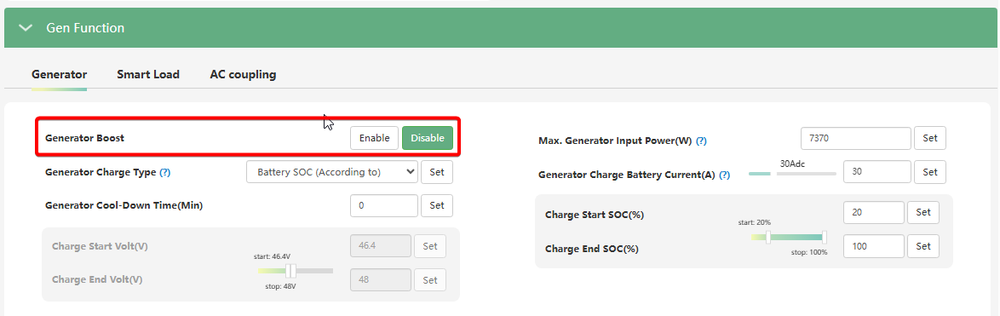

# Generator Boost (Підтримка генератора / GEN BOOST)

## Призначення

Ця функція дозволяє системі використовувати енергію від сонячних панелей (PV) та акумуляторної батареї для **допомоги генератору** у живленні навантаження, якщо потужності самого генератора стає недостатньо.

## Доступ

| Installer Web | End-User Web | Mobile App | Display (LCD) |
| :-----------: | :----------: | :--------: | :-----------: |
|      ✅       |      ❌      |     ❌     |     ✅ 30     |

У вебінтерфейсі змінювати цей параметр можуть лише облікові записи `Installer` або `Distributor`. На дисплеї інвертора — пункт **30** (`GEN BOOST`).

## Діапазон значень

- **`Disable` (Вимкнено):** інвертор не використовує сонячні панелі та батарею для компенсації нестачі потужності генератора в режимі GEN Boost. Значення за замовчуванням. В такій конфігурації бажано щоб генератор мав достатню потужність щоб забезпечити заряд батареї та живлення споживачів. LuxPower рекомендує, щоб номінальна потужність генератора принаймні в 1,5 раза перевищувала вихідну потужність інвертора для забезпечення як живлення навантаження, так і потреб заряджання акумулятора. В інакшому випадку генератор може заглохнути через надмірне навантаження.
- **`Enable` (Увімкнено):** якщо навантаження перевищує заданий ліміт генератора, інвертор може покрити нестачу від сонячних панелей та батареї.

## Рекомендовані значення

- **`Enable`**, якщо номінальна потужність генератора менша за пікове навантаження, а сонячні панелі та/або батарея можуть покрити різницю. Функція не гарантує захисту генератора від коротких пускових піків.

## Логіка роботи

Ліміт для GEN Boost задається окремим параметром [`Max. Generator Input Power`](/settings/gen_max_input_power_w).

- **Навантаження не перевищує ліміт.**
  - Незалежно від стану `Generator Boost`, генератор у першу чергу використовується для живлення навантаження.
  - Пріоритет заряджання АКБ: PV > Генератор (надлишок над споживанням на виході інвертора)

- **Навантаження перевищує ліміт, `Generator Boost` увімкнено.**
  - Інвертор підмішує енергію до генератора
  - Пріоритет джерел: генератор → PV → батарея.
  - Батарея покриває залишок до досягнення [`Off-Grid Cut-Off SOC`](/settings/off_grid_cut_off_soc) або [`Off-Grid Cut-Off Volt`](/settings/off_grid_cut_off_volt), залежно від способу керування розрядом.
- **Навантаження перевищує ліміт, `Generator Boost` вимкнено.**
  - Підмішування відсутнє.
  - Генератор може піти в захист від перевантаження, а живлення на виході EPS інвертора — перерватися.

## Примітки та важливі обмеження

> [!WARNING] Апаратні обмеження (Підтримка моделями):
> Функція `Generator Boost` вимагає наявності внутрішнього трансформатора струму (CT) на порту GEN. Це можливо на інверторах серії SNA6000, та нових версіях SNA5000 (де в серійному номері є літера `V`). Старі версії інверторів (без вбудованого CT на порту генератора) цю функцію не підтримують: на них сонячна енергія не зможе підтримувати генератор у живленні навантаження для безпеки самого генератора.

> [!WARNING] Захисний алгоритм (5%-10% запас)
> Для запобігання роботи генератора на критичній межі та захисту від частих коливань навантаження система автоматично закладає 5%-10% запас безпеки. Реальна максимальна потужність, яка забирається від генератора, обмежена на рівні 90%~95% X Max. Generator Input Power. Решта навантаження компенсується інвертором.

> [!WARNING] Може не працювати
> Деякі користувачі повідомляють що в них `Generator Boost` не працює, через що малопотужні генератори (як інверторні так і звичайні) ідуть в захист, і система переходить на батарею. Ймовірна причина: Перемикання на підміс відбувається не миттєво, а триває кілька напівперіодів мережевої синусоїди, через що захист генератора від надмірного навантаження може спрацьовувати раніше ніж інвертор почне підміс. Також GEN Boost може не справлятись при миттєвих пускових струмах важких двигунів/насосів.

## Коли змінювати

Вмикайте (`Enable`) цю функцію, якщо генератору не вистачає потужності для живлення окремих приладів, а доступної потужності сонячних панелей або батареї може вистачити для компенсації.
