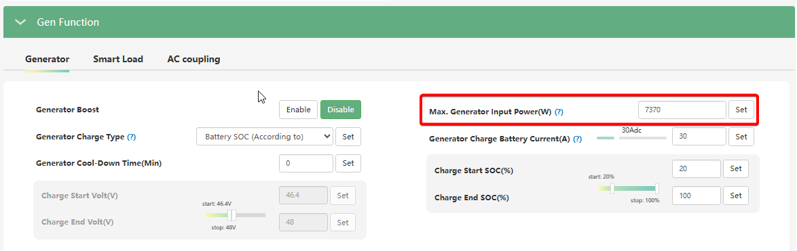

# Max. Generator Input Power (W)

###### Потужність генератора

## Призначення

Цей параметр повідомляє інвертору **номінальну робочу потужність** підключеного генератора (у Ватах).

Інвертор використовує це значення для керування потужністю генератора. Пріоритет має живлення будинку, а залишок потужності генератора може йти на заряджання батареї. Коли навантаження зростає, інвертор може зменшити струм заряджання. З увімкненим [`Generator Boost`](/settings/gen_generator_boost) значення також задає поріг підмішування, а не гарантовану миттєву межу споживання з порту GEN.

## Доступ

| Installer Web | End-User Web | Mobile App | Display (LCD) |
| :-----------: | :----------: | :--------: | :-----------: |
|      ✅       |      ?       |     ?      |     ✅ 17     |

_(На РК-дисплеї інвертора цей параметр налаштовується під індексом **17**)._

## Діапазон значень

- **Мінімум:** 0 Вт.
- **Максимум (для 1 інвертора):** 7370 Вт. (Апаратний ліміт порту GEN становить 60А).
- **Максимум (для паралельної системи):** 65534 Вт.
- **Крок:** 1 Вт.
- **За замовчуванням:** 7370 Вт.

## Рекомендовані значення

Вам потрібно ввести **номінальну (постійну) потужність** вашого генератора, а не його максимальну (пікову) потужність.

- Наприклад, якщо на генераторі написано "Max 3.3 kW, Rated 3.0 kW", сюди слід вписати `3000`.
- Якщо у вас інверторний генератор, який погано переносить тривалі пікові навантаження, вказуйте навіть трохи менше значення (наприклад, 2500 - 2800 для 3-кіловатного генератора).

## Примітки та важливі особливості

> [!NOTE] **Запас потужності: 90% чи 95%?**
> У попередньому описі вікі для вебпідказки наведено 90% від заданого значення. Документ LuxPower *SNA GEN Boost Function* (rev. 1.1, с. 3) описує 5% запасу: середня максимальна вхідна потужність генератора становить 95% від заданого значення. Чи стосуються ці цифри однакових умов роботи, не підтверджено. Жодне з цих значень не слід трактувати як гарантовану миттєву межу.

> [!WARNING] **Якщо навантаження перевищує заданий ліміт**
> З вимкненим [`Generator Boost`](/settings/gen_generator_boost) цей параметр не гарантує обмеження навантаження, яке живиться від генератора. Наприклад, якщо задано `3000 Вт`, а навантаження сягає `4000 Вт`, генератор може піти в захист. З увімкненим `Generator Boost` інвертор може покрити нестачу спочатку від сонячних панелей, а потім від батареї — у межах доступної потужності цих джерел.

## Коли змінювати:

Цей параметр необхідно **обов'язково** налаштувати під час підключення генератора. За замовчуванням тут стоїть максимум (7370 Вт). Якщо ви підключите звичайний генератор на 3 кВт і не зміните це значення, при першому ж запуску інвертор спробує потягнути з нього максимум потужності для швидкого заряджання батареї, що миттєво "задушить" і зупинить ваш генератор.
