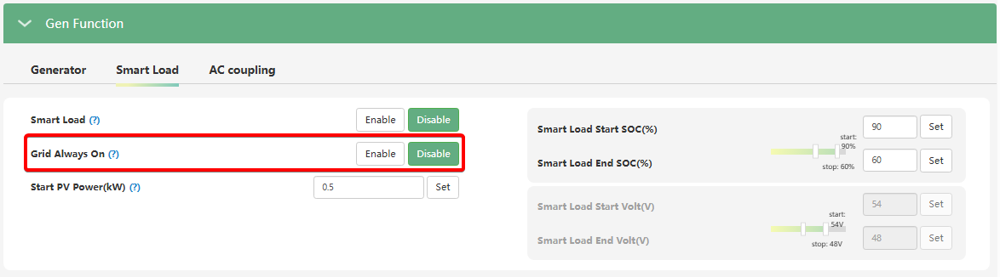

# Smart Load -> Grid Always On

###### (Увімкнення за наявності мережі)

## Призначення

Цей параметр є частиною функції "Розумного навантаження" ([Smart Load](/settings/smart_load)). Він визначає, чи буде порт генератора (GEN), який налаштовано як додатковий вихід, отримувати безперервне живлення весь час, поки доступна зовнішня електромережа (Grid).

## Доступ

| Installer Web | End-User Web | Mobile App | Display (LCD) |
| :-----------: | :----------: | :--------: | :-----------: |
|      ✅       |      ?       |     ?      |     ✅ 31     |

_(На РК-дисплеї інвертора ця функція налаштовується в меню **31** під назвою `Smart Load GridOn`)._

## Діапазон значень

- **`Disable` (Вимкнено):** Значення за замовчуванням. Живлення на порт [Smart Load](/settings/smart_load) подається **виключно** за умовами по рівню заряду батареї та сонячній генерації (PV), які ви налаштували раніше, незалежно від того, чи є напруга в міській мережі.
- **`Enable` (Увімкнено):** Коли підключено до мережі, розумне навантаження залишається безперервно підключеним до живлення (порт працює в режимі наскрізного пропускання).

## Логіка роботи

Цей параметр розділяє логіку роботи порту на два сценарії:

1. **Мережа присутня (Grid On):** Якщо функцію увімкнено (`Enable`), порт [Smart Load](/settings/smart_load) працює як звичайна домашня розетка. Інвертор просто пропускає струм з мережі на підключений прилад (наприклад, бойлер або кондиціонер), тимчасово ігноруючи налаштування сонячної потужності ([`Start PV Power`](/settings/smart_load_start_pv_power_kw)) та відсотків заряду батареї ([`Smart Load SOC`](/settings/smart_load_start_stop)).
2. **Мережа відсутня (Grid Off / Блекаут):** Щойно міська мережа зникає, інвертор переходить до класичного алгоритму [Smart Load](/settings/smart_load) (гістерезис за SOC з "дозволом" на роботу порту та умовою по сонцю між порогами — див. таблицю на сторінці [Smart Load](/settings/smart_load#логіка-роботи)). Без мережі значення `Grid Always On` ні на що не впливає: поведінка порту однакова при `Enable` і `Disable`. Що відбувається з портом у момент зникнення мережі:
   - **SOC ≥ [`Start SOC`](/settings/smart_load_start_stop):** порт залишається під напругою, навіть якщо сонця немає (підтверджено двома тестами при SOC 100% під час імітації вечірнього відключення, зокрема з тривалим очікуванням після вимкнення сонця). Вночі порт вимкнеться, щойно SOC опуститься нижче [`Start SOC`](/settings/smart_load_start_stop) (_потребує перевірки_).
   - **SOC між [`End SOC`](/settings/smart_load_start_stop) і [`Start SOC`](/settings/smart_load_start_stop), сонце є (понад [`Start PV Power`](/settings/smart_load_start_pv_power_kw)):** порт залишається під напругою, поки є сонце і SOC вище [`End SOC`](/settings/smart_load_start_stop). Чи зберігається "дозвіл" на роботу порту, якщо до блекауту порт живився від мережі через `Grid Always On`, а SOC ще не досягав [`Start SOC`](/settings/smart_load_start_stop), — _потребує перевірки_.
   - **SOC між [`End SOC`](/settings/smart_load_start_stop) і [`Start SOC`](/settings/smart_load_start_stop), сонця немає:** порт знеструмлюється через 1–2 хв, хоча в батареї ще може бути багато енергії. Коли сонце повернеться, порт увімкнеться одразу (якщо дозвіл не скинутий).
   - **SOC ≤ [`End SOC`](/settings/smart_load_start_stop):** порт знеструмлюється незалежно від сонця.

> [!NOTE] Перевірено практично
> Описана поведінка відтворена за практичними тестами користувача на прошивці `cBaa-33919A`.

## Примітки та важливі обмеження

> [!WARNING] Сумісність функцій порту:
> Використання порту GEN в режимі [Smart Load](/settings/smart_load) (навіть з увімкненим Grid Always On) забороняє одночасне підключення до цього ж порту паливного генератора або мережевого інвертора ([AC Coupling](/settings/ac_couple)). Якщо зустрічна напруга потрапить на цей порт під час роботи функції [Smart Load](/settings/smart_load), це може призвести до пошкодження пристрою.

> [!WARNING] Вимкнення параметра скидає стан порту:
> Живлення порту від мережі через `Grid Always On` не "запам'ятовується" гістерезисом [Smart Load](/settings/smart_load). Якщо порт живився від мережі і ви перемкнули параметр на `Disable`, порт знеструмиться і чекатиме, поки SOC досягне [`Smart Load Start SOC`](/settings/smart_load_start_stop) (якщо SOC вже вищий — порт залишиться під напругою). Поки SOC нижчий за [`Start SOC`](/settings/smart_load_start_stop), повернення сонця саме по собі порт не увімкне.

## Коли змінювати:

- **Встановлюйте `Disable`**, якщо ваша головна мета — **максимальна економія**. У цьому режимі ваш бойлер чи зарядка електромобіля працюватимуть лише за умовами [Smart Load](/settings/smart_load): при сонці (поки SOC вище [`End SOC`](/settings/smart_load_start_stop)) або при майже повній батареї (SOC ≥ [`Start SOC`](/settings/smart_load_start_stop)), а не просто тому, що в мережі є напруга.
- **Встановлюйте `Enable`**, якщо до порту [Smart Load](/settings/smart_load) підключено прилад для комфорту (наприклад, кондиціонер або той самий бойлер), і ви хочете, щоб він гарантовано працював у звичайному режимі від мережі вночі або в похмуру погоду. А от під час блекаутів цей прилад ставатиме "другорядним": вдень він працюватиме за наявності сонця, поки SOC вище [`End SOC`](/settings/smart_load_start_stop), а вночі під час блекауту — лише поки SOC не нижче [`Start SOC`](/settings/smart_load_start_stop). Для живлення другорядного навантаження від батареї під час нічного блекауту функція [Smart Load](/settings/smart_load) підходить обмежено: саме [`Start SOC`](/settings/smart_load_start_stop) визначає, скільки енергії батареї віддасть на це навантаження.
